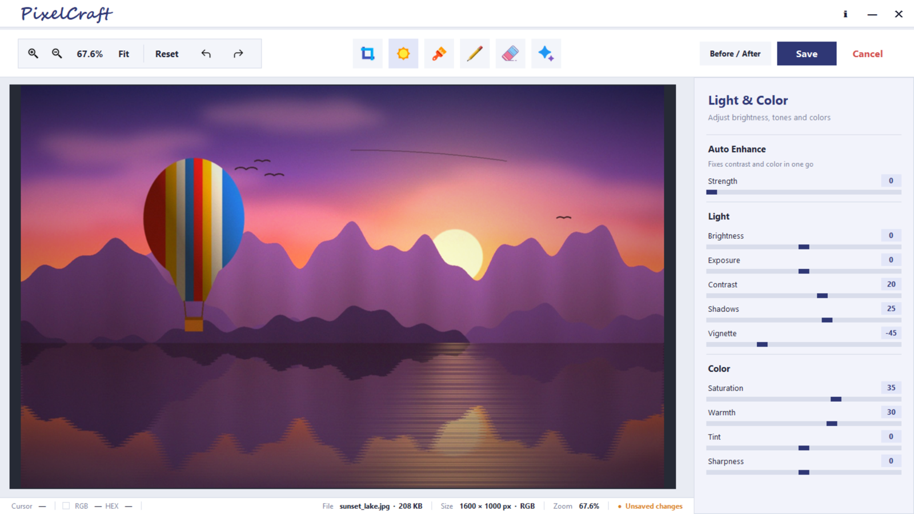
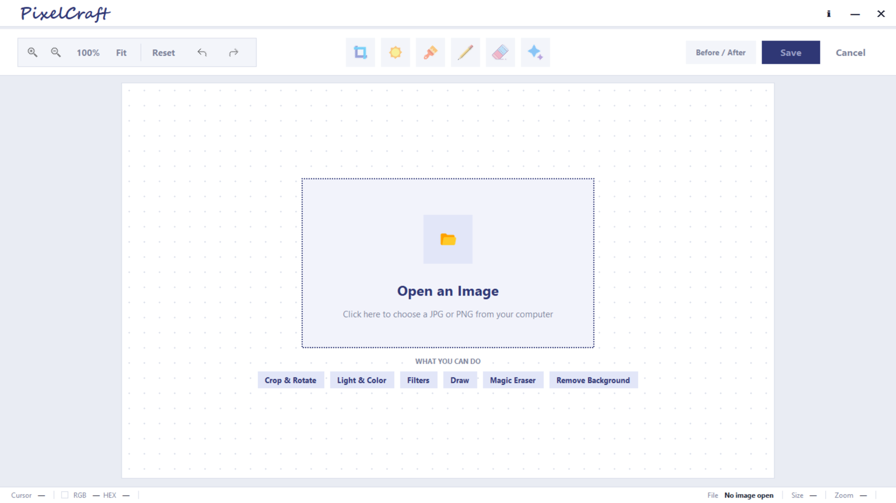
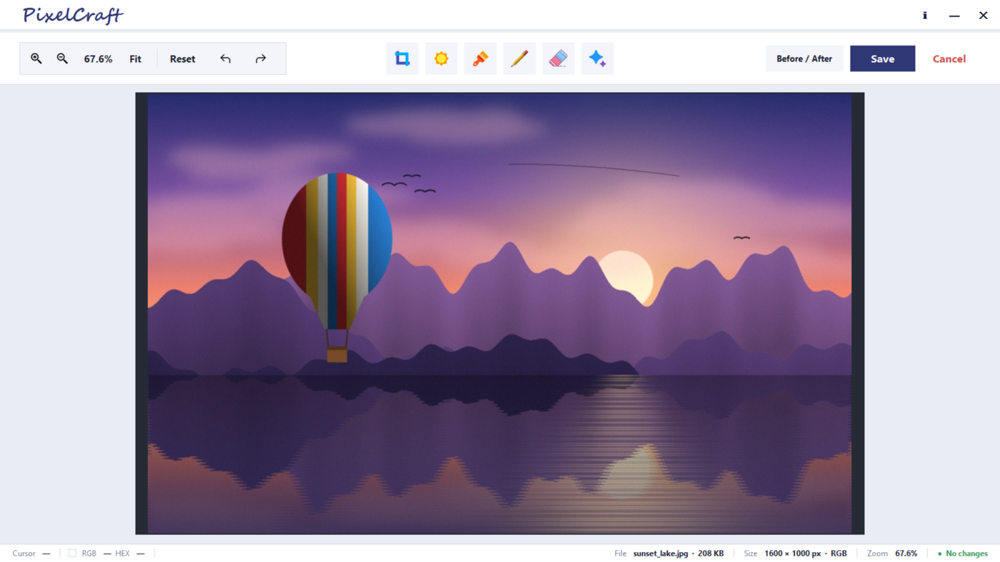
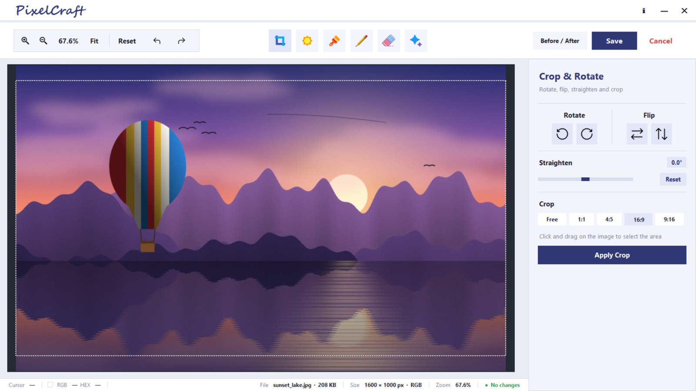
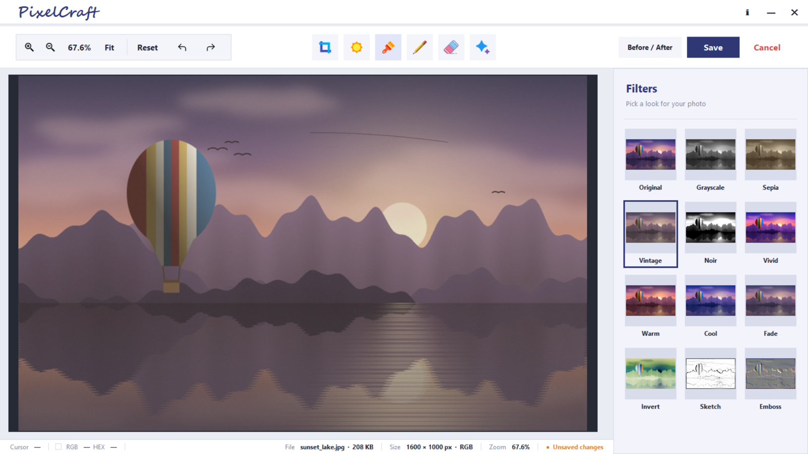
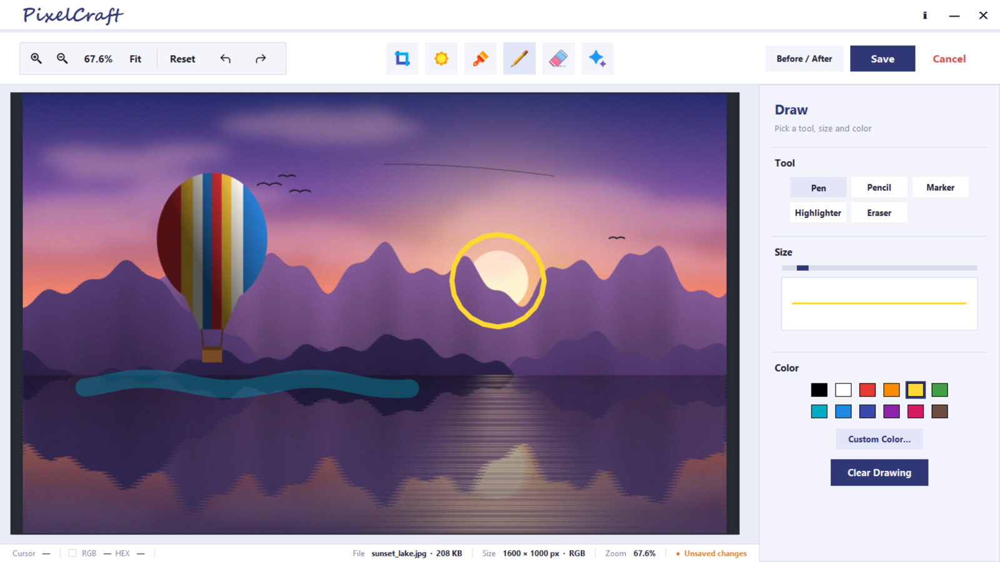
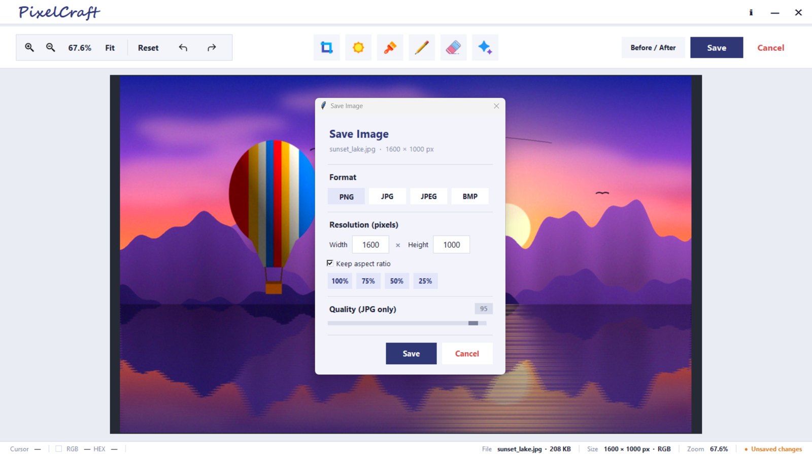
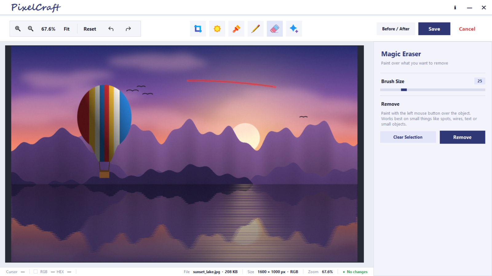
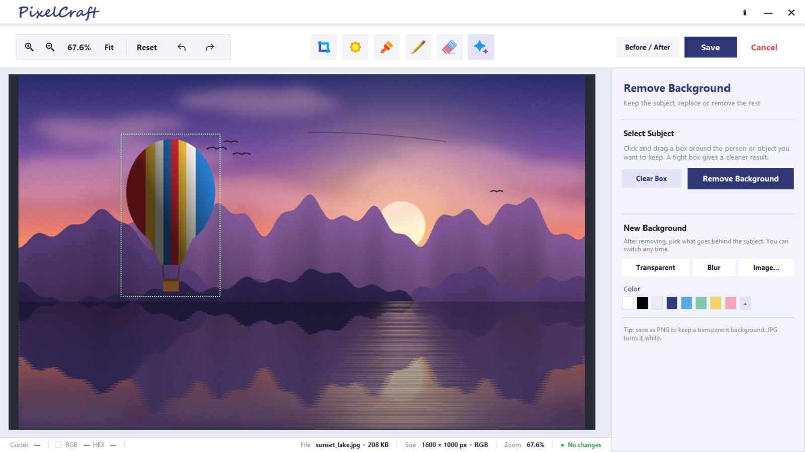

<h1 align="center">PixelCraft</h1>

<p align="center">
  A simple, fast desktop photo editor built with Python, Tkinter, OpenCV and Pillow.<br>
  Fix light and color, crop, add filters, draw, remove objects and backgrounds, then save in the format you need.
</p>

<p align="center">
  
  
  
  
</p>

<p align="center">
  
</p>

---

## Features

| Tool | What it does |
| --- | --- |
| **Crop & Rotate** | Rotate 90°, flip horizontally/vertically, straighten from −90° to +90° (edges are filled automatically), crop freely or with a 1:1, 4:5, 16:9 or 9:16 ratio |
| **Light & Color** | One-slider Auto Enhance, plus Brightness, Exposure, Contrast, Shadows, Vignette, Saturation, Warmth, Tint and Sharpness |
| **Filters** | 12 looks with live thumbnails: Original, Grayscale, Sepia, Vintage, Noir, Vivid, Warm, Cool, Fade, Invert, Sketch, Emboss |
| **Draw** | Pen, Pencil, Marker, Highlighter and Eraser with adjustable size, a 12-color palette and a custom color picker |
| **Magic Eraser** | Paint over spots, wires, text or small objects and they're filled in from their surroundings (OpenCV inpainting) |
| **Remove Background** | Draw a box around the subject to cut it out (OpenCV GrabCut), then choose a transparent, blurred, solid-color or image background |
| **Save** | Export as PNG, JPG/JPEG or BMP, resize on export (with a lock-aspect option and 100/75/50/25% presets), set JPG quality |

Also:

- **Non-destructive editing.** Adjustments and filters are stored as settings and re-applied to the image, so you can change them at any time.
- **Undo / Redo** for every edit, plus a one-click **Reset** back to the original.
- **Before / After.** Hold the button to compare with the original photo.
- **Zoom & pan.** Zoom from 20% to 1000%, fit to screen, and drag to pan when zoomed in.
- **Status bar** showing the cursor position, the pixel color under the cursor (RGB + HEX), image size, zoom level and unsaved-changes state.
- **Scales to any screen.** The layout and fonts adjust to your screen size.

## Screenshots

<table>
  <tr>
    <td width="50%"><p align="center"><b>Start screen</b></p></td>
    <td width="50%"><p align="center"><b>Editor</b></p></td>
  </tr>
  <tr>
    <td><p align="center"><b>Crop & Rotate</b>: 16:9 crop box</p></td>
    <td><p align="center"><b>Filters</b>: Vintage</p></td>
  </tr>
  <tr>
    <td><p align="center"><b>Draw</b>: pen and highlighter</p></td>
    <td><p align="center"><b>Save</b>: format, size and quality</p></td>
  </tr>
</table>

### Magic Eraser

| Paint over the power line… | …and it's gone |
| --- | --- |
|  |  |

### Remove Background

| Box the subject… | …and swap the background (blurred here) |
| --- | --- |
|  |  |

## Getting Started

### Requirements

- Python 3.10 or newer (Tkinter ships with the standard Windows installer)
- [OpenCV](https://pypi.org/project/opencv-python/), [NumPy](https://pypi.org/project/numpy/), [Pillow](https://pypi.org/project/pillow/)

### Install & run

```bash
git clone https://github.com/YashPame/PhotoEditingApplication.git
cd PhotoEditingApplication
pip install opencv-python numpy pillow
python main.py
```

> Run `main.py` from the project folder: icons are loaded from the `Icons/` directory relative to where you start the app.

The app opens fullscreen. Use the **✕** button in the top-right corner to close it, or **—** to minimize.

### Build a standalone `.exe` (optional)

```bash
pip install pyinstaller
pyinstaller --onefile --windowed --name PixelCraft --add-data "Icons;Icons" main.py
```

The executable is created at `dist/PixelCraft.exe` and runs without Python installed.

## Keyboard Shortcuts

| Shortcut | Action |
| --- | --- |
| `Ctrl + O` | Open an image |
| `Ctrl + S` | Save |
| `Ctrl + Z` / `Ctrl + Y` | Undo / Redo |
| `+` / `-` or mouse wheel | Zoom in / out |
| `Ctrl + 0` | Fit to screen |
| Drag (when zoomed in) | Pan. While a tool uses the left button, pan with the middle or right button. |

## How It Works

Every edit is rebuilt from a small pipeline instead of being painted straight onto the photo:

```
base image ──► light & color adjustments ──► filter ──► + drawing layer ──► shown / saved image
```

- **Geometry and pixel edits** (rotate, flip, crop, straighten, magic eraser, background removal) change the base image. The drawing layer is transformed along with it so strokes stay in place.
- **Adjustments and filters** are stored as settings and re-applied with Pillow on each render.
- **Drawing** lives on its own transparent layer, composited on top.
- **Undo/Redo** keeps snapshots of this state (last 10 steps per image).

## Project Structure

```
├── main.py                  # App window, theme, layout scaling
├── Core/
│   ├── image_document.py    # Per-image state (original, edits, undo stacks, zoom)
│   └── image_editor.py      # Editing engine: render pipeline, transforms, filters, undo/redo
├── Components/
│   ├── top_header.py        # Title bar (About / minimize / close)
│   ├── action_bar.py        # Toolbar, shortcuts, panel switching
│   ├── editor_canvas.py     # Image canvas with scrollbars and panning
│   ├── status_bar.py        # Cursor, color, size, zoom, saved state
│   ├── save_dialog.py       # Export dialog
│   └── Panels/              # Crop, Light, Filters, Draw, Eraser, Background panels
└── Icons/                   # UI icons
```

## Authors

- **Yash Pame**
- **Ansh Choube**
